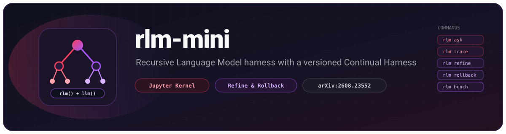

<p align="center">
  
</p>

<p align="center">
  <a href="https://www.python.org/downloads/"></a>
  <a href="https://arxiv.org/abs/2608.23552"></a>
  
  <a href="https://github.com/aayushhzz/rlm-mini/stargazers"></a>
  <a href="https://github.com/aayushhzz/rlm-mini/issues"></a>
</p>

<p align="center">
  <a href="#architecture">Architecture</a> •
  <a href="#quick-start">Quick Start</a> •
  <a href="#cli-reference">CLI Reference</a> •
  <a href="#demo-results">Demo Results</a> •
  <a href="#testing">Testing</a> •
  <a href="PAPER_NOTES.md">Paper Notes</a> •
  <a href="docs/architecture.md">Architecture Docs</a>
</p>

---

**`rlm-mini`** is a small, working **Recursive Language Model (RLM)** harness with a **Continual Harness**, independently implemented from **Prime Agent: A Self-Improving RLM Harness** (Karten, Zhang, et al., [arXiv:2608.23552](https://arxiv.org/abs/2608.23552), official code at [PrimeIntellect-ai/prime-agent](https://github.com/PrimeIntellect-ai/prime-agent)).

Instead of stuffing a 295k-character corpus into the prompt, `rlm-mini` binds it as `ctx` inside a persistent **Jupyter Python kernel**. The root model writes Python cells (`grep`, `chunk`, slicing, loops) and can invoke `llm()` for cheap sub-calls or `rlm()` for recursive child agents with their own kernels. Only truncated cell outputs return to the root model, keeping prompt corpus exposure strictly under `8,000` characters. On top, `rlm refine` turns trajectory evidence into one small, versioned edit to `harness_state/` with instant byte-exact `rlm rollback`.

See [PAPER_NOTES.md](PAPER_NOTES.md) for the paper-to-code map and [docs/architecture.md](docs/architecture.md) for runtime internals.

## Architecture

```mermaid
flowchart TB
    Q["User Question + ~295k Corpus (ctx)"] --> R["Root Model (depth 0)<br/>system = base_system_prompt.md + harness_state/"]
    R -->|"```python cell```"| K["Persistent Jupyter Kernel<br/>ctx, grep(), chunk(), FINAL(), harness"]
    K -->|"truncated output (cap ≤8000 corpus chars)"| R
    K -->|"llm(prompt)"| SUB["Sub-model call"]
    K -->|"rlm(prompt, sub_ctx) / rlm.spawn()"| CHILD["Child RLM Agent (depth + 1)<br/>own kernel & runs/&lt;child&gt;.jsonl"]
    CHILD --> K
    R --> LOG["runs/&lt;session&gt;.jsonl"]
    LOG --> REF["rlm refine → 1 evidence-backed edit<br/>harness_state/{prompts,skills,memory}.json"]
    REF --> SNAP["harness_state/snapshots/sNNNN<br/>(rlm rollback restores exact bytes)"]
```

## Quick Start

### Installation

```bash
git clone https://github.com/aayushhzz/rlm-mini.git
cd rlm-mini

python3 -m venv .venv
.venv/bin/pip install -e '.[dev]'

# Default backend uses the local Claude Code CLI login:
claude auth status          # expects loggedIn: true (claude.ai)

# Optional local backend via Ollama:
ollama pull qwen3:8b && ollama pull qwen3:4b-instruct
```

### Run

```bash
# Ask a question over the ~295k-char generated corpus (or pass --ctx FILE)
.venv/bin/rlm ask "In the free-text operator notes, one vendor is the target of a complaint. Which vendor?"

# Inspect the execution tree and per-call token accounting
.venv/bin/rlm trace <session-id>

# Verify no logged root/child prompt exceeded the corpus-char cap
.venv/bin/rlm check-logs

# Continual Harness: refine from the last trajectory, list snapshots, rollback
.venv/bin/rlm refine && .venv/bin/rlm snapshots
.venv/bin/rlm rollback s0001

# 3-arm benchmark (prompt stuffing vs RLM vs RLM + refines)
.venv/bin/rlm bench --ids q01,q08,q10,q19,q20      # small Claude run
.venv/bin/rlm --backend ollama bench               # all 20 questions, local

# Offline test suite (real Jupyter kernel, fake backend)
.venv/bin/python -m pytest -q
```

## CLI Reference

Entrypoint `rlm` ([rlm/cli.py](rlm/cli.py)). Global flags `--backend`, `--model`, `--sub-model`, and `--home` go before the subcommand.

| Command | Key Flags | What It Does |
|---|---|---|
| `rlm ask "question"` | `--ctx FILE`, `--max-turns` (`8`) | Answers over the ~295k-char corpus bound as `ctx`. Corpus never enters the prompt. |
| `rlm trace <session>` | — | Renders cells and nested `llm()`/`rlm()` sub-calls as a tree with per-call tokens. |
| `rlm check-logs` | `--cap` (`8000`) | Re-measures every logged root/child prompt and fails (exit `1`) if any exceeds `--cap` corpus chars. |
| `rlm refine` | `--session ID` | Reviews a trajectory and writes one evidence-backed edit to `harness_state/` with snapshot + diff. |
| `rlm rollback <id>` | — | Restores the edited file in `harness_state/` to its exact pre-edit bytes. |
| `rlm snapshots` | — | Lists all Continual Harness snapshots with trigger and outcome. |
| `rlm bench` | `--limit N`, `--ids q01,..`, `--rounds 3`, `--out FILE` | Runs 3 arms — (a) 80k prompt stuffing, (b) RLM, (c) RLM + `/refine` rounds — and writes `results.md`. |

**Kernel helpers** ([rlm/repl_api.py](rlm/repl_api.py)): `ctx`, `grep(text, pattern)`, `chunk(text, n)`, `llm(prompt)`, `rlm(prompt, sub_ctx)`, `rlm.spawn(prompt, sub_ctx)` (returns a `Future`), `harness` (`rlm.harness`), and `FINAL(answer)`.

## Backends & Configuration

All model calls pass through `complete(system, messages, role)` in [rlm/backends.py](rlm/backends.py):

- **`claude`** *(default)*: runs `claude -p --output-format json --tools ""` from an empty temp directory using the local Claude Code login (`ANTHROPIC_API_KEY` is stripped).
- **`ollama`** *(local)*: uses native `/api/chat` (`qwen3:8b` root, `qwen3:4b-instruct` sub-calls, `num_ctx=32768` for stuffing).
- **`fake`**: scripted/rule-based backend for offline tests.

| Environment Variable | Default | Purpose |
|---|---|---|
| `RLM_BACKEND` | `claude` | Backend (`claude`, `ollama`, `fake`), inherited by kernels & child agents |
| `RLM_MODEL` / `RLM_SUB_MODEL` | *(backend default)* | Root and `llm()` sub-call model overrides |
| `RLM_CELL_TIMEOUT` | `240` | Per-cell execution timeout in seconds |
| `RLM_CORPUS_CAP` | `8000` | Maximum corpus characters allowed in any root/child prompt |
| `RLM_MAX_DEPTH` | `2` | Maximum recursion depth for `rlm()` |
| `RLM_EFFORT` | `low` | `--effort` flag passed to `claude -p` |
| `RLM_HOME` | *(project root)* | State directory for `runs/`, `harness_state/`, and `bench/` |

> **Terms note:** The default `claude` backend uses your personal Claude Code CLI login and is meant for personal local use. Deploying it for other users requires switching to API-key authentication per Anthropic's terms.

## Demo Results

Real runs via the local Claude Code CLI (no API key, raw logs in [demo/](demo/), [runs/](runs/), and [results.md](results.md)):

- **`rlm ask`** ([demo/ask.txt](demo/ask.txt)): answered `Zentrix Cloud` in 9 turns (`35,092` tokens).
- **Recursive `rlm()` + `llm()`** ([demo/trace_recursive.txt](demo/trace_recursive.txt)): root passed 402 `[ops-note]` lines (48,726 chars) to a depth-1 `rlm()` child, which mapped `llm()` over 15,000-char chunks (depth 2, 5 sub-calls, `39,441` total tokens).
- **Corpus cap check** ([demo/check_logs.txt](demo/check_logs.txt)): `85` logged prompts checked; max corpus chars in one prompt = **3,432** (cap `8,000`) → **PASS**.
- **Refine & Rollback** ([demo/refine.txt](demo/refine.txt), [demo/rollback.txt](demo/rollback.txt)): wrote `s0001` (`create memory/operator_notes_format`) with verbatim log evidence; `rlm rollback s0001` restored byte-identical SHA-256 hashes.

### 3-Arm Benchmark (5 questions: 2 aggregations, 1 late needle, 2 free-text — [results.md](results.md))

| Arm | Accuracy | Total Tokens | Mean Tokens / Q | Max Depth | Sub-calls |
|---|---|---|---|---|---|
| (a) Prompt stuffing (first 80k chars) | 0/5 (0%) | 202,112 | 40,422 | 0 | 0 |
| (b) RLM | **5/5 (100%)** | 88,093 | 17,618 | 0 | 0 |
| (c) RLM + 3 refines | **5/5 (100%)** | **86,248** | **17,249** | 0 | 0 |

See [results_claude_semantic.md](results_claude_semantic.md) for the follow-up 2-question semantic run.

## Project Structure

```text
rlm-mini/
├── assets/
│   └── banner.svg                 # Repository hero banner
├── docs/
│   └── architecture.md            # Kernel loop, corpus cap, and Continual Harness design
├── rlm/
│   ├── cli.py                     # `rlm` CLI entrypoint
│   ├── agent.py                   # Root/child RLM loop and corpus-cap enforcement
│   ├── kernel.py                  # Persistent Jupyter kernel wrapper with cell timeouts
│   ├── repl_api.py                # In-kernel helpers: ctx, grep, chunk, llm, rlm, FINAL
│   ├── harness.py                 # Versioned Continual Harness + byte-exact snapshots
│   ├── refine.py                  # Evidence-backed single-edit trajectory refiner
│   ├── trace.py                   # JSONL session logging, tree renderer, check-logs
│   ├── backends.py                # Claude CLI, Ollama, and fake model backends
│   ├── corpus.py                  # Deterministic ~295k-char repo/log corpus + 20 gold Qs
│   ├── bench.py                   # 3-arm isolated benchmark runner
│   └── base_system_prompt.md      # Immutable base system prompt
├── tests/                         # 14 offline pytest tests (real Jupyter kernel + fake backend)
├── demo/                          # Recorded CLI outputs and benchmark logs
├── paper/prime-agent.pdf          # Reference paper
├── PAPER_NOTES.md                 # Concept-to-code mapping and simplifications
├── pyproject.toml
└── README.md
```

## Testing

```bash
.venv/bin/python -m pytest -q
```

Runs 14 offline tests using a real Jupyter kernel and the `fake` backend covering corpus-cap enforcement, output elision, nested `llm()`/`rlm()` trees, cell timeouts, single-edit `refine` validation, byte-exact `rollback`, base prompt immutability, and the 3-arm benchmark.

## Limits

- **Not a sandbox.** Model-written Python executes as your local user with full filesystem and network permissions — use only with trusted inputs.
- **Stateless `claude -p` turns.** Each turn invokes a fresh CLI call (~1k cached system-context overhead).
- **Synchronous `rlm()` / threaded `rlm.spawn()`.** No daemon, agent-to-agent messaging, compaction, or crash recovery (see [PAPER_NOTES.md](PAPER_NOTES.md)).
- **Point-in-time rollback.** Rolling back an older snapshot restores that file to its exact pre-edit bytes, discarding subsequent edits to that same file.
- **In-sample bench refinement.** The bench's refine rounds learn from the same question set scored in arm (c) (though gold-answer leaks are rejected).

---

<p align="center">
  Built by <a href="https://github.com/aayushhzz">aayushhzz</a> •
  <a href="https://github.com/aayushhzz/rlm-mini/issues">Report an Issue</a> •
  <a href="https://github.com/aayushhzz">More Projects</a>
</p>
